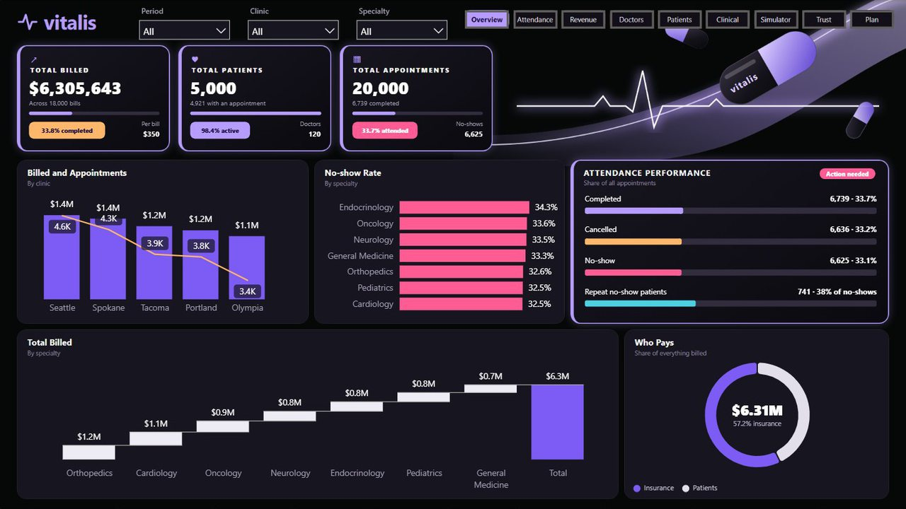
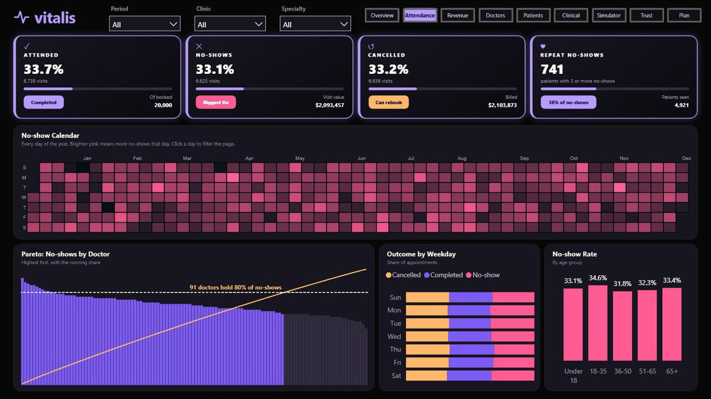
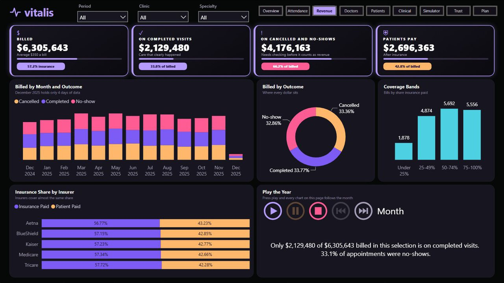
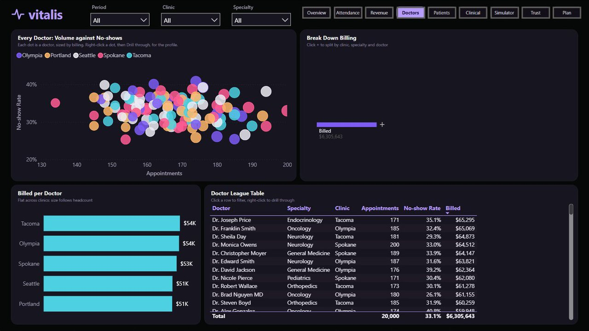
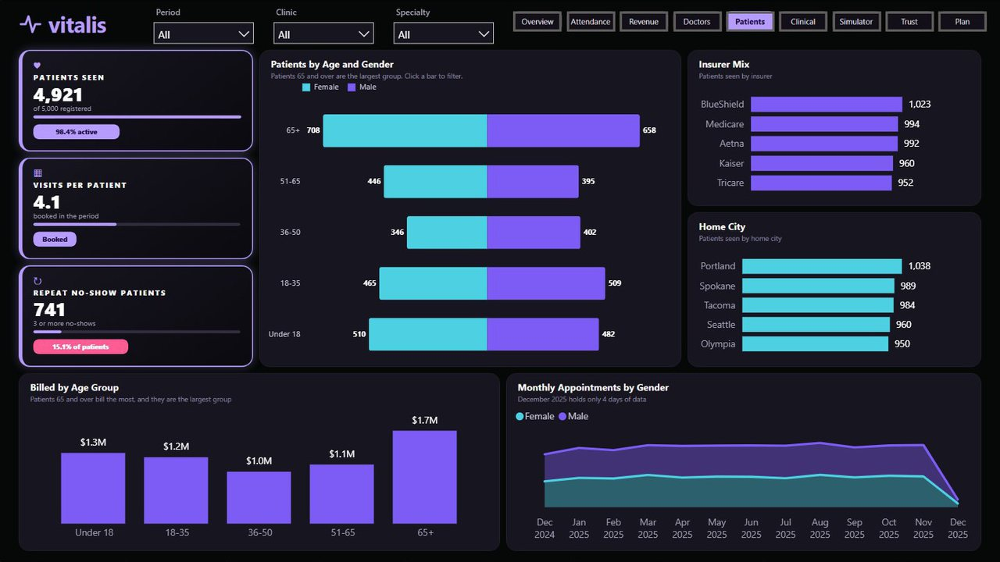
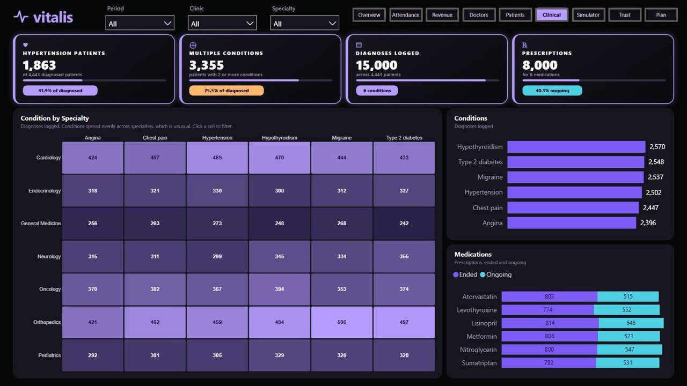
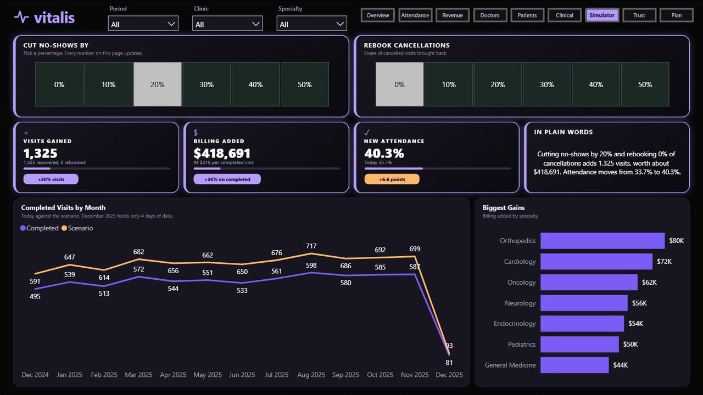
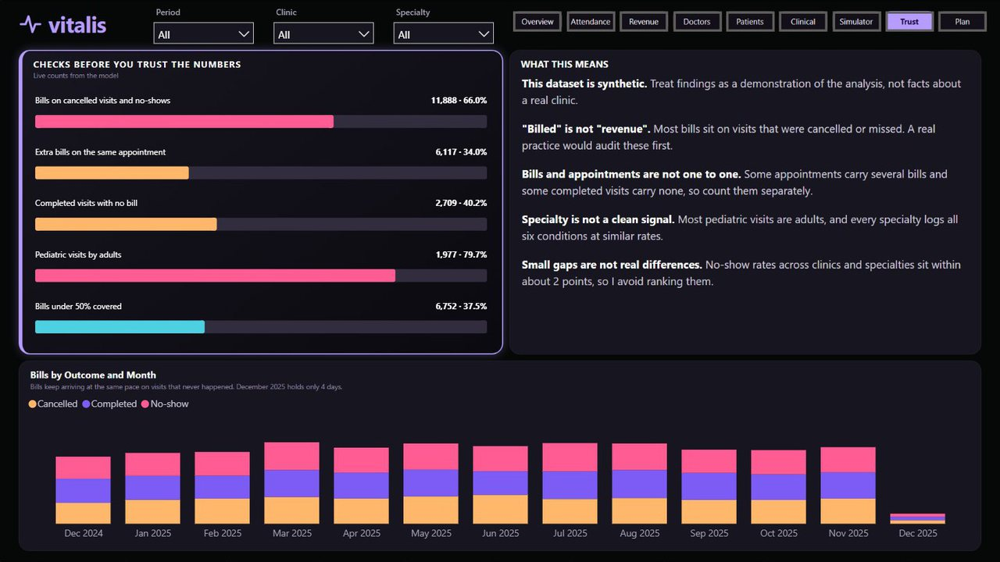
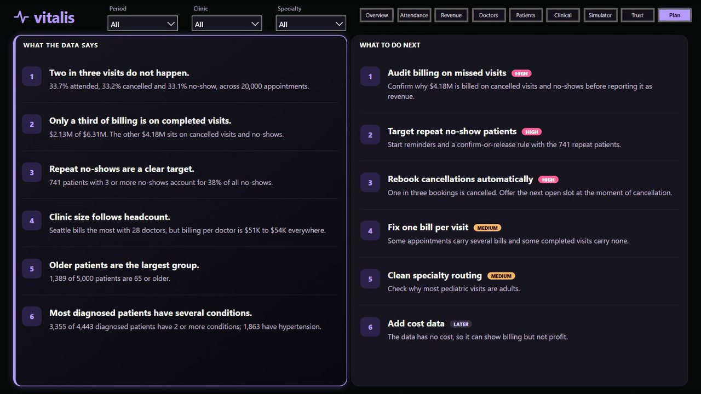

<div align="center">

# Vitalis Healthcare

**A nine-page Power BI report on five clinics, with a live no-show simulator.**

[**▶ Watch every page (73 seconds)**](https://bihbrandysango-cloud.github.io/projects/vitalis/)

</div>

[](https://bihbrandysango-cloud.github.io/projects/vitalis/)

> **Synthetic data.** Treat findings as a demonstration of the analysis, not facts about a real clinic.

## What is in the report

| Page | What it shows |
|---|---|
| Overview | Billing, patients and appointments, by clinic and specialty |
| Attendance | A no-show calendar for every day, and a Pareto chart of no-shows by doctor |
| Revenue | Billing by outcome, insurer share, coverage bands and a Play button for the year |
| Doctors | All 120 doctors, a decomposition tree and a league table |
| Patients | Age and gender, insurer and home city |
| Clinical | Conditions by specialty as a heatmap, and medications |
| Simulator | What cutting no-shows and rebooking cancellations would be worth |
| Data Trust | Live checks to run before believing the numbers |
| Findings and Plan | Six findings and six actions |
| Doctor Profile | A drill-through page for one doctor |

Built with Power BI, DAX (61 measures), Power Query and Deneb (calendar, Pareto chart, heatmap, neon cards).

### Open it yourself

Open [`powerbi/Vitalis Healthcare.pbip`](powerbi/) in Power BI Desktop. Its data folder is set to the original computer, so to refresh, change the `DataFolder` parameter to this repo's [`data/`](data/) folder. Deneb and Play Axis are included in the project.

## Headline findings

| Metric | Value | Note |
|---|---|---|
| Appointments | **20,000** | Dec 2024 to Dec 2025, across 5 clinics and 120 doctors |
| Attended | **33.7%** | 33.2% cancelled, 33.1% no-show |
| Billed | **$6.31M** | 18,000 bills |
| Billed on completed visits | **$2.13M** | The other $4.18M sits on cancelled visits and no-shows |
| Repeat no-show patients | **741** | Three or more no-shows, 38% of all no-shows |
| Billed per doctor | **$51K to $54K** | Flat across clinics, so clinic size follows headcount |
| Patients with hypertension | **1,863** | Of 4,443 diagnosed patients |
| Patients with 2 or more conditions | **3,355** | 75.5% of diagnosed patients |

## Pages

### 1. Overview


### 2. Attendance



### 3. Revenue



### 4. Doctors



### 5. Patients



### 6. Clinical



### 7. Simulator



### 8. Data Trust



### 9. Findings and Plan



---

## Earlier versions

The first version of this project is kept here: [`powerbi/HEALTHCARE_PROJECT.pbix`](powerbi/HEALTHCARE_PROJECT.pbix), the [documentation deck](docs/Vitalis-Project-Documentation.pdf), the [SQL queries](sql/healthcare_queries.sql) and the [React web app](https://bihbrandysango-cloud.github.io/vitalis-healthcare/web/vitalis.html). The earlier deck and old Power BI link show the first report, and some figures there have been corrected above.

---

## Repository structure

```
vitalis-healthcare/
│
├── README.md                       This file
├── LICENSE                         MIT
├── CONTRIBUTING.md                 How to contribute
├── .gitignore
│
├── docs/                           Project documentation
│   ├── Vitalis-Project-Documentation.pdf    ← renders inline on GitHub
│   ├── Vitalis-Project-Documentation.pptx   ← editable PowerPoint
│   └── screenshots/                Dashboard + hero screenshots
│
├── sql/                            SQL deliverable
│   └── healthcare_queries.sql      17 analytical queries
│
├── powerbi/                        Power BI deliverable
│   └── HEALTHCARE_PROJECT.pbix     The interactive workbook
│
└── web/                            Vitalis web app
    ├── vitalis.html                Single-file build (run in browser)
    ├── vitalis-source.zip          Vite project source
    └── vitalis-netlify-deploy.zip  Drag-and-drop deployment bundle
```

---

## Deployment

### First Power BI report — already deployed ✅

The first version of the report is live at:
https://app.powerbi.com/links/SsuRswiz5q?ctid=74283479-689a-49e8-9a3b-d4098db086cb&pbi_source=linkShare

### Web app — already deployed ✅

The single-file build is served by GitHub Pages at:
https://bihbrandysango-cloud.github.io/vitalis-healthcare/web/vitalis.html

To host your own copy elsewhere, unzip [`web/vitalis-netlify-deploy.zip`](web/vitalis-netlify-deploy.zip) and drag the folder onto [app.netlify.com/drop](https://app.netlify.com/drop).

---

## Run it locally

If you'd rather develop locally than deploy:

```bash
# 1. Clone
git clone https://github.com/bihbrandysango-cloud/vitalis-healthcare.git
cd vitalis-healthcare

# 2. SQL — load schema and queries into PostgreSQL
psql -d your_database -f sql/healthcare_queries.sql

# 3. Power BI — open powerbi/Vitalis Healthcare.pbip

# 4. Web app dev server
unzip web/vitalis-source.zip -d web/vitalis
cd web/vitalis
npm install
npm run dev
# → http://localhost:5173
```

---

## Key insights

1. **Two in three visits do not happen.** Only 33.7% of 20,000 appointments were completed.

2. **Only a third of billing is on completed visits.** $2.13M of $6.31M. A real practice would audit the other $4.18M before calling it revenue.

3. **Repeat no-shows are a clear target.** 741 patients with three or more no-shows account for 38% of all no-shows.

4. **Clinic size follows headcount.** Seattle bills $1.43M with 28 doctors and Olympia $1.08M with 20, but billing per doctor is about the same.

5. **Most diagnosed patients have several conditions.** 3,355 of 4,443 have two or more, and 1,863 have hypertension.

---

## Recommendations

| Priority | Action | Why |
| -------- | ------ | --- |
| High | Audit billing on missed visits | $4.18M is billed on cancelled visits and no-shows |
| High | Target repeat no-show patients | 741 patients drive 38% of no-shows |
| High | Rebook cancellations automatically | One in three bookings is cancelled |
| Medium | Fix one bill per visit | Some appointments carry several bills, and 40.2% of completed visits have none |
| Medium | Clean specialty routing | 79.7% of pediatric visits are adults |
| Later | Add cost data | The data can show billing but not profit |

---

## Tech stack

| Layer            | Technologies                                                |
| ---------------- | ----------------------------------------------------------- |
| **Data**         | PostgreSQL 14+                                              |
| **Analytics**    | Power BI Desktop, DAX, Power Query, Deneb                   |
| **Web app**      | React 18, Vite 5, Tailwind CSS, Recharts, Framer Motion     |
| **Persistence**  | LocalStorage (web app), file-based (.pbix, .sql)            |
| **Tooling**      | npm, Git                                                    |

---

## Contributing

Contributions, corrections, and forks are welcome. See [**CONTRIBUTING.md**](CONTRIBUTING.md) for guidelines.

---

## License

This project is licensed under the MIT License — see [**LICENSE**](LICENSE) for details.

---

<div align="center">

**Quick access**

[▶ Watch every page](https://bihbrandysango-cloud.github.io/projects/vitalis/) ·
[📄 Documentation PDF](docs/Vitalis-Project-Documentation.pdf) ·
[🌐 Web app source](web/vitalis-source.zip) ·
[🗄️ SQL queries](sql/healthcare_queries.sql)

</div>
